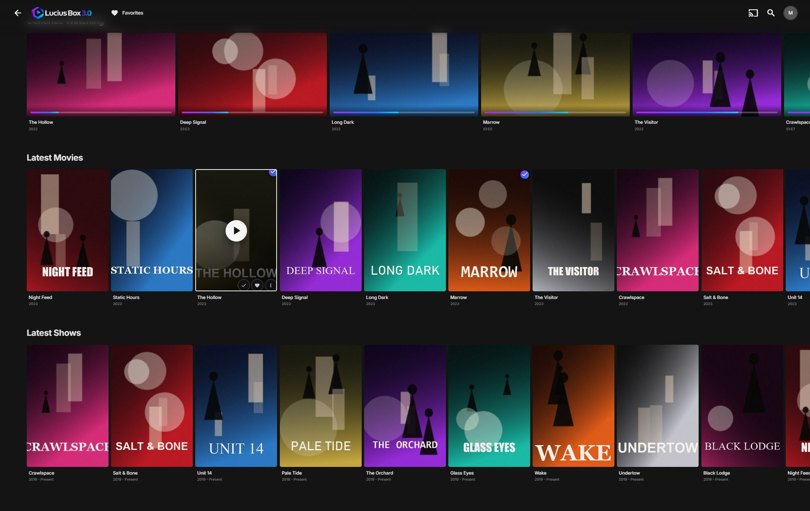
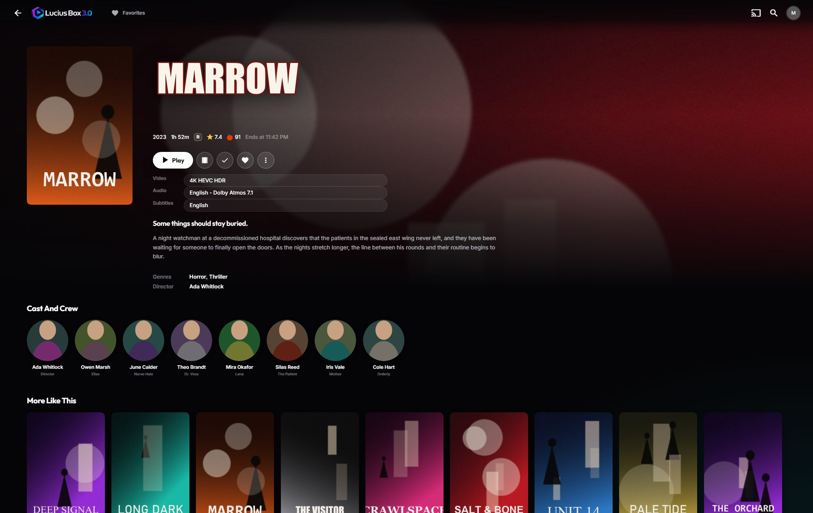
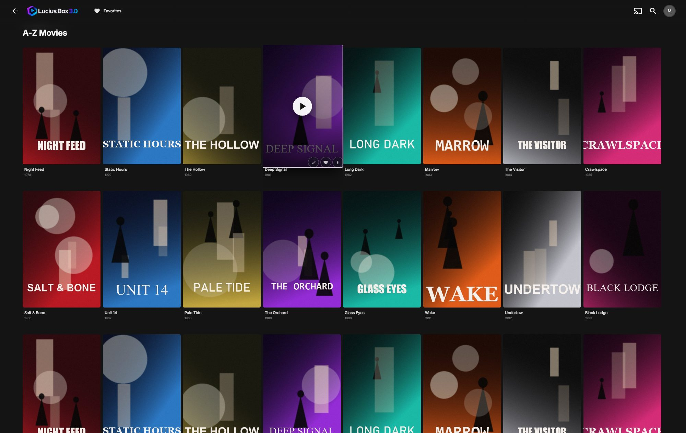
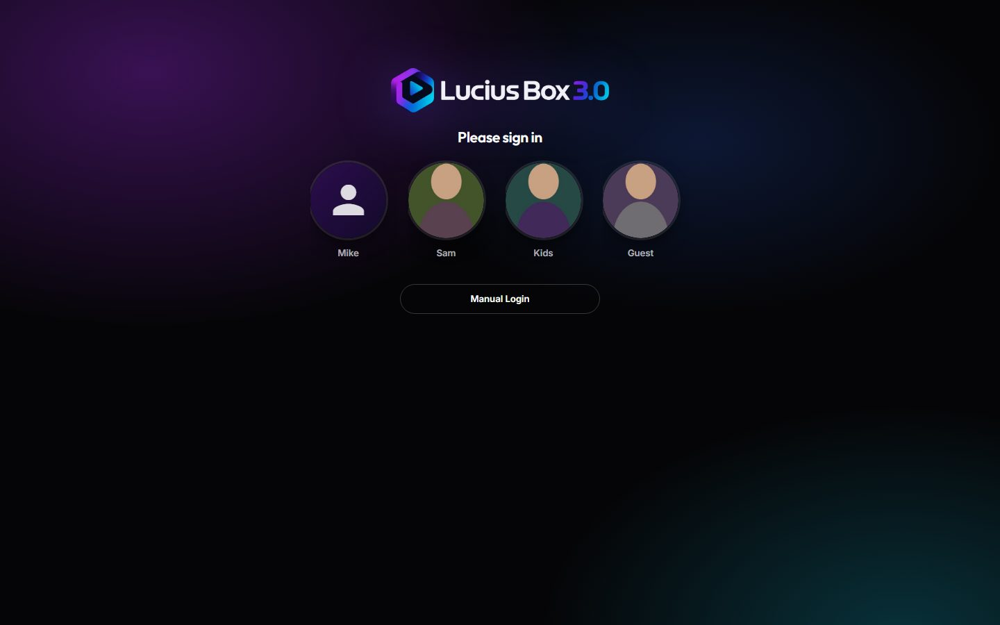

# Lucius Box 3.0: a Jellyfin theme

A full streaming-app makeover for Jellyfin 12. It works in the Modern and
Legacy layouts, on desktop, phones and TV.




- **Header:** clear over the content. Whatever scrolls underneath fades and
  blurs. The full Lucius Box logo replaces Jellyfin's.
- **Home:** big bold row titles, with an "explore" arrow when you point at
  one. Pointing at a card zooms the picture inside its frame and outlines
  it in white, with a white play button.
- **Movie and show pages:** a full-screen backdrop with the title, info,
  a white **Play** button and round outlined buttons laid over it, with the
  poster beside them. Cast photos are round.
- **Sign-in:** "Who's watching?" with square profile pictures, and a dark
  password card.
- **Everything else:** a flat streaming-app black (#141414), one clean
  sans font, small crisp corners, grey inputs and menus, and the logo's
  purple and blue as the highlight colour for progress bars, toggles and
  the selected menu item.

| Library | Sign-in |
|---|---|
|  |  |

## Install

**Option 1: link to this repo (it updates itself).** This only works while
the repo is public. Put this single line in **Dashboard → Branding → Custom
CSS**, save, then press Ctrl+F5:

```css
@import url("https://cdn.jsdelivr.net/gh/stratabased/luciusbox-jellyfin-theme@main/dist/luciusbox.css");
```

jsDelivr caches `@main` for up to 12 hours. To see a new version straight
away, open the same URL with `purge.jsdelivr.net` in place of
`cdn.jsdelivr.net`.

**Option 2: paste it.** Copy all of `dist/luciusbox.css` into the same box.
The logo is embedded, so nothing needs hosting.

Custom CSS applies wherever Jellyfin Web runs: the browser, the desktop
app, Android, and web-based TV apps. Native apps like Swiftfin and Findroid
don't load it.

## Options

Add any of these under the `@import` line. Keep the `html:root[data-theme]` part so they win over the theme:

```css
html:root[data-theme] {
  --lb-hover-zoom: 1;          /* turn off the hover zoom */
  --lb-radius: 6px;            /* squarer cards */
  --lb-violet: #8b5cf6;        /* change the accent colours */
  --lb-cyan: #22d3ee;
}
```

Every setting is in the first block of `src/luciusbox.css`.

## Build

- `python tools/logo.py` makes the dark-background logo from
  `assets/logo-original.png` and needs Pillow and NumPy.
- `python tools/build.py` writes `dist/luciusbox.css` with the logos
  embedded.

## Files

| Path | What it is |
|---|---|
| `dist/luciusbox.css` | The theme, ready to use |
| `src/luciusbox.css` | The source |
| `assets/` | The original logo and its dark-background versions |
| `tools/` | Logo processing and build scripts |
| `screenshots/` | The pictures above, taken on mock pages built from Jellyfin 12's own markup and stylesheets |
